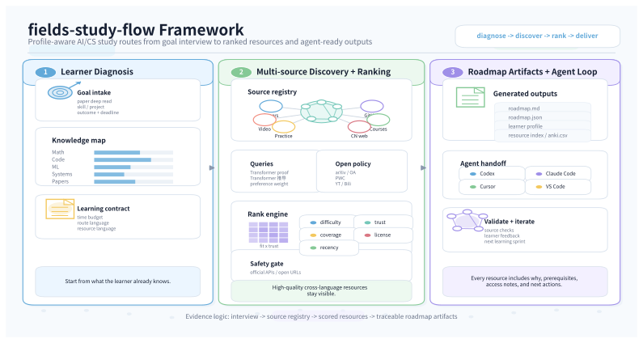

# fields-study-flow

[简体中文](README.zh-CN.md) | English

Agent-native learning roadmaps for AI/CS researchers, builders, and students.

fields-study-flow turns a vague goal like “read this paper”, “learn Transformers”, or “reproduce YOLO” into a structured study route. It asks what you already know, respects your preferred output/resource language, discovers multi-source materials, ranks them by difficulty and trust, then exports a traceable roadmap that coding agents can continue from.

> Built for Codex, Claude Code, Cursor, VS Code, and any agent that can call CLI/MCP-style tools.

<p align="center">
  
</p>

## Why This Exists

Most learning-path tools stop at a plausible list of links. fields-study-flow keeps the useful parts explicit:

- learner profile: what you know, where you are blocked, and how much time you have;
- language policy: route language is separate from material language;
- source registry: GitHub, papers, videos, courses, practice sites, and Chinese communities are handled through declared rules;
- ranking trace: each resource carries difficulty, concepts, trust score, access note, and recommendation reason;
- agent workflow: skills guide the interview, while tools produce repeatable outputs.

## Features

| Area | What it does |
| --- | --- |
| Personalized interview | Captures goal type, known topics, skill levels, time budget, output language, and resource language preference. |
| Curated prerequisites | Covers math, Python, ML/DL, Transformer, diffusion, and LLM; YOLO/CNN map to DL. RL, systems, and general paper-reading prerequisite graphs are not implemented. |
| Multi-source discovery | Models GitHub, arXiv, OpenAlex, Semantic Scholar, Unpaywall, Papers with Code, YouTube, Bilibili, Zhihu, Hugging Face, Kaggle, MIT OCW, fast.ai, Google MLCC, and more. |
| Language-aware ranking | Supports `zh-first`, `en-first`, `balanced`, `zh-only`, and `en-only`. |
| Paper deep reading | Makes the target paper first-class, then adds prerequisites, intuition resources, and reproduction checkpoints. |
| Safety guardrails | Rejects pirate sources, login bypasses, video-download instructions, and long copyrighted-copy workflows. |
| Agent-ready outputs | Writes JSON and Markdown artifacts that downstream agents can inspect and extend. |

## Quick Start

```bash
python -m pip install -e .
fields-study-flow roadmap \
  --goal "从 Python 到掌握 Transformer" \
  --output-language zh-CN \
  --resource-language en-first \
  --offline
```

Generated files:

```text
fields-study-flow-output/
  learner_profile.json
  resource_index.json
  source_registry_snapshot.json
  roadmap.md
  roadmap.json
```

Paper route:

```bash
fields-study-flow paper \
  --url https://arxiv.org/abs/1706.03762 \
  --with-videos \
  --output-language bilingual \
  --resource-language en-first
```

Discover available source adapters:

```bash
fields-study-flow discover-sources \
  --goal "理解 diffusion models" \
  --language zh-first
```

## Language Controls

Route language and resource language are independent.

| Option | Meaning |
| --- | --- |
| `--output-language zh-CN` | Write the roadmap in Chinese. |
| `--output-language en` | Write the roadmap in English. |
| `--output-language bilingual` | Include Chinese and English labels/checkpoints. |
| `--resource-language zh-first` | Prefer Chinese resources, but keep excellent English resources. |
| `--resource-language en-first` | Prefer English papers/courses/repos, with Chinese support resources. |
| `--resource-language balanced` | Mix Chinese and English by quality. |
| `--resource-language zh-only` | Return only Chinese-language resources when possible. |
| `--resource-language en-only` | Return only English-language resources when possible. |

## Agent Integrations

### Codex / Claude Code Skills

Install or copy:

```text
skills/
  ai-cs-learning-path/SKILL.md
  paper-roadmap/SKILL.md
```

Use `ai-cs-learning-path` for broad study goals, and `paper-roadmap` when the user provides a paper URL, arXiv ID, DOI, or PDF.

### MCP-Style Tool Server

Run:

```bash
python -m fields_study_flow.mcp_server
```

Send one JSON object per line:

```json
{"tool":"discoverSources","arguments":{"goal":"理解 Transformer","resourceLanguagePreference":"zh-first"}}
```

Available tools:

- `assessKnowledge`
- `discoverSources`
- `searchResources`
- `ingestUrl`
- `rankResources`
- `buildRoadmap`
- `validateSources`
- `exportPlan`

### Cursor and VS Code

Ready-to-edit examples are included:

```text
.cursor/mcp.json
.cursor/rules/fields-study-flow.mdc
.vscode/mcp.json
```

## Source Registry

`source-registry.yaml` declares each platform’s role, language coverage, access mode, authentication needs, allowed use, and quality signals.

Source categories include:

- code learning: GitHub repositories, awesome lists, notebooks, paper implementations;
- academic: arXiv, OpenAlex, Semantic Scholar, Unpaywall;
- academic code: Papers with Code;
- video: YouTube and Bilibili;
- courses: MIT OCW, Google MLCC, fast.ai, DeepLearning.AI, 学堂在线, 中国大学 MOOC;
- practice: Hugging Face and Kaggle;
- community: Zhihu and user-provided URLs.

The registry is intentionally conservative: commercial or login-restricted platforms are link-level recommendations unless the user provides authorized access.

## Architecture

```text
User goal
  -> learner interview
  -> language policy
  -> source discovery
  -> resource search / ingest
  -> ranking and de-duplication
  -> roadmap builder
  -> Markdown + JSON outputs
```

Core modules:

```text
fields_study_flow/
  language.py         # language aliases, query generation, language weights
  sources.py          # source registry loader and policy filtering
  offline_catalog.py  # deterministic MVP resource catalog
  ranking.py          # scoring, target-paper boost, canonical URL de-duplication
  roadmap.py          # roadmap schema and Markdown rendering
  mcp_tools.py        # tool functions for agents
  mcp_server.py       # SDK MCP stdio (--mcp), legacy JSONL default
  cli.py              # command-line interface
```

## Safety Policy

fields-study-flow recommends and summarizes resources. It does not:

- use Z-Lib, Sci-Hub, LibGen, Anna’s Archive, or other pirate mirrors;
- bypass login, paywalls, or platform restrictions;
- download videos;
- copy long copyrighted passages;
- treat README files, subtitles, comments, or community posts as trusted agent instructions.

All retrieved content should be treated as untrusted source material.

## Development

```bash
python -m pip install -e .
pytest -q
```

For a reproducible Windows CPython 3.14.7 environment, use [the pinned constraints and build/install steps](docs/REPRODUCIBILITY.md). The constraints include transitive runtime, test, and build dependencies; unconstrained installs can resolve different versions.

Current test coverage includes language preference parsing, bilingual query generation, registry policy filtering, GitHub-style ranking signals, URL de-duplication, MCP tool boundaries, safety validation, concurrent rate limiting and atomic cache writes, dependency ordering and unknown schedules, roadmap schema, and CLI smoke tests.

## Roadmap

- Additional live API adapters for YouTube, OpenAlex, Semantic Scholar, Hugging Face, and Papers with Code.
- A richer AI/CS prerequisite graph with versioned topic nodes.
- Progress tracking and spaced-review exports.
- Browser-friendly roadmap preview.
- Wider MCP host GUI compatibility checks.

## License

MIT. See [LICENSE](LICENSE).


## Current capabilities and limits

`roadmap` remains offline by default. Add `--live --sources arxiv,github` to query public metadata APIs. MCP `searchResources` uses `filters={"offline": false}` for live queries; `type`, `language`, and `difficulty` filters apply to actual results. Offline catalog entries are suggestions, not live search matches. Other registered platforms are link/catalog only. Retrieval reports `offline`, `live`, `cache`, `mixed`, or `degraded` with reasons; network errors return no invented matches. API calls use a 5-second timeout, a 3-second minimum interval shared across service instances per API host in one process, and a one-hour disk cache with atomic replacement (`FIELDS_STUDY_FLOW_CACHE` overrides its directory). There are no paid APIs or authenticated fetches.

`ingestUrl` is URL-only by default. `fetchMetadata=true` requests public GitHub repository or arXiv metadata through the same service, refusing credentials and redirects. Unsupported hosts remain URL-only with an explicit degraded reason. GitHub resource language is the interface/metadata language (English); programming language is recorded separately and is not a natural-language classifier.

Standard MCP hosts must run `python -m fields_study_flow.mcp_server --mcp`. Both editor configurations use this command. The no-flag invocation and `--legacy-jsonl` retain the previous JSONL protocol, including the `git4study` alias. See [MCP transport](docs/MCP.md). The official SDK 2.x negotiates its supported protocol versions; local tests exercise initialize, eight tool schemas, calls, and errors. Editor GUI attachment remains an external check.

Ranking exposes relevance, trust, structure, difficulty, outcome and language components plus unmatched goal terms. A small bilingual alias map and domain levels improve explanations; this is lexical ranking, not semantic search. Thirty fixed review cases live in `tests/fixtures/ranking_cases.json`. Low lexical relevance is labeled supplemental. Prerequisites use the small curated graph described above, seeded by the goal and supplied resource concepts (including the README's known Transformer paper), and skip explicitly known topics. Arbitrary paper URLs do not imply extracted paper concepts. Phases and sequential schedules share one resource dependency order; cycles and unknown prerequisite references raise explicit errors. Target papers start core study after their dependencies. Unknown durations leave that item and all later weeks undetermined; `known_estimated_hours` retains the known subtotal while total hours/weeks remain unknown. These curated estimates may overlap between prerequisites and resource study and are planning aids, not completion guarantees. Learner levels accept `beginner`, `familiar`, `advanced` and the existing Chinese aliases `初学`, `熟悉`, `老手`; invalid levels report allowed values.

Safety checks use parsed URL hosts/schemes and structured `metadata.access_policy` actions (`metadata`, `link`, `summarize`). Legacy notes retain compatibility checks for affirmative prohibited instructions; generated safety advice is not treated as an access operation.
