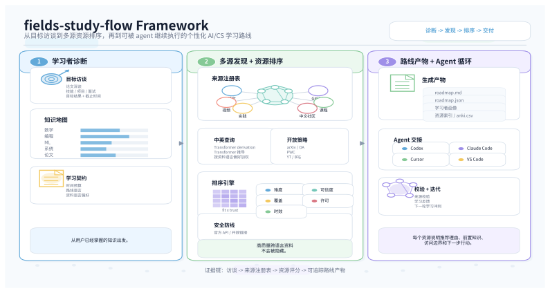

# fields-study-flow

## 给初学者讲一篇论文

对宿主 Agent 说：“我是初学者，请按动机—方法—实验—效果（结果）—不足—展望详细讲解，不要小标题或列表，尽量用成段文字。”`paper-roadmap` skill 会调用 `explainPaper` 整理证据，再由宿主核实材料、生成自然精讲。六个论述阶段可以各有多段，不强制六段或固定字数。

```bash
fields-study-flow explain-paper --url examples/paper-explainer/abstract.json --json
fields-study-flow explain-paper --url https://arxiv.org/abs/1706.03762 --text-file examples/paper-explainer/body.txt --language zh
```

这两个示例都离线，示例文件是明确标注的合成教学材料。本地 JSON 支持标题、作者、abstract/summary、年份和分类；本地 UTF-8 文本与 `--text-file` 以空行分隔正文段落。`--level` 默认 beginner，语言支持 zh/en。仅传 arXiv abs/PDF URL 时才沿用现有适配器请求公开元数据，不下载 PDF 正文；其他远端 URL 请改为提供材料。

后端输出明确标为“离线材料梳理”，不宣称理解或精讲任意论文。JSON 提供六阶段候选证据、短摘录、来源/段落定位、缺失清单和精讲契约；纯文本无小标题、无列表。中英文关键词规则可能漏检或误分类；宿主必须回查原材料、解释首次出现的术语、区分作者结论和一般背景。没有全文就说明只依据摘要或用户正文，没有结果就提示补充结果表，不编造数字、作者不足或展望，不把英文原句拼接当中文精讲。开发与测试不调用付费模型，宿主自然精讲能力取决于其自身配置。

## 可复现论文路径与边界

CLI/MCP 默认离线。`roadmap --live`、`ingest-url --fetch-metadata` 或 MCP `filters.offline=false` / `fetchMetadata=true` 才请求公开 arXiv/GitHub 元数据。`paper` CLI 保持离线精选路线，不解析任意论文。arXiv abs/PDF 链接通过 Atom API 规范化标题、作者、摘要（summary）、年份、分类和去版本 ID，不下载 PDF 正文。DOI/普通 PDF 仅保留链接并解释限制：可手工提供元数据/概念标签或改用 arXiv URL。

运行 `python -m pytest tests/test_paper_path_e2e.py -q`，固定 Atom fixture 覆盖 URL→元数据→先修图→阶段检查点→JSON 导出，以及 404、超时、429、缺摘要降级。元数据不可用仍可生成最小路线；无摘要明确标记仅按标题匹配。先修图只覆盖数学、Python、机器学习、深度学习、Transformer、diffusion、LLM 等有限词表；自由文本访问策略只是有限英语规则，推荐结构化策略，不声称理解任意论文。

检索 filters 支持 pages（1–10，默认 1）、page_size（1–100，默认 10），固定提供方排序并按 ID 去重；远端更新仍可能移动分页边界，不保证快照。缓存保留来源和 UTC 抓取时间，默认一小时过期，损坏自动重建；原子替换防止进程内多实例读取半写文件，并发 miss 可能重复请求。限流间隔默认每主机 3 秒，仅进程内共享；429/错误不自动重试，不抓登录内容。

每个阶段包含可观察完成条件。未知时长保留未知，已知时长仅为小计；每周预算同时影响周排期与截止日容量。shortfall_hours 表示已知时长缺口，有未知时长时只是下界，估算可能重叠，不保证实际按期完成。


简体中文 | [English](README.md)

面向 AI/CS 研究者、工程师和学生的 agent-native 学习路线生成器。

fields-study-flow 可以把“读懂这篇论文”、“学习 Transformer”、“复现 YOLO”这类模糊目标，转成一条结构化、可追踪、可继续迭代的学习路线。它会先了解你的已有知识、语言偏好和时间预算，再从论文、GitHub、课程、视频、实践平台和中文社区中整理资源，按难度、可信度和前置知识排序，最后导出 Markdown 与 JSON。

> 为 Codex、Claude Code、Cursor、VS Code 以及任何可调用 CLI/MCP 工具的 agent 设计。

<p align="center">
  
</p>

## 为什么做这个项目

很多学习路线生成工具只会给出一串“看起来合理”的链接。fields-study-flow 把真正影响学习质量的部分显式建模：

- 学习者画像：你会什么、卡在哪里、每周能投入多久；
- 语言策略：路线语言和资料语言分开控制；
- 来源注册表：GitHub、论文库、视频平台、公开课程、实践平台、中文社区都有明确规则；
- 排序依据：每个资源都有难度、覆盖概念、可信度、访问说明和推荐理由；
- Agent 工作流：skills 负责访谈和流程，工具层负责稳定生成输出。

## 核心功能

| 能力 | 说明 |
| --- | --- |
| 个性化访谈 | 收集目标类型、已知知识、各领域水平、时间预算、路线语言和资料语言偏好。 |
| 人工维护的先修图 | 覆盖数学、Python、ML/DL、Transformer、diffusion、LLM；YOLO/CNN 映射到 DL。尚未实现 RL、系统和通用论文阅读的先修图。 |
| 多源资源发现 | 覆盖 GitHub、arXiv、OpenAlex、Semantic Scholar、Unpaywall、Papers with Code、YouTube、Bilibili、知乎、Hugging Face、Kaggle、MIT OCW、fast.ai、Google MLCC 等。 |
| 语言感知排序 | 支持 `zh-first`、`en-first`、`balanced`、`zh-only`、`en-only`。 |
| 论文深读路线 | 把目标论文放入依赖之后的核心阶段，使用已有概念标签补充先修，并提供复现检查点。 |
| 安全边界 | 拒绝盗版来源、绕登录、下载视频、长篇复制版权内容等不合规路径。 |
| Agent 友好输出 | 生成 Markdown 与 JSON，方便后续 agent 继续执行、复盘或扩展。 |

## 快速开始

```bash
python -m pip install -e .
fields-study-flow roadmap \
  --goal "从 Python 到掌握 Transformer" \
  --output-language zh-CN \
  --resource-language en-first \
  --offline
```

生成文件：

```text
fields-study-flow-output/
  learner_profile.json
  resource_index.json
  source_registry_snapshot.json
  roadmap.md
  roadmap.json
```

论文深读路线：

```bash
fields-study-flow paper \
  --url https://arxiv.org/abs/1706.03762 \
  --with-videos \
  --output-language bilingual \
  --resource-language en-first
```

查看可用资料源：

```bash
fields-study-flow discover-sources \
  --goal "理解 diffusion models" \
  --language zh-first
```

## 语言控制

路线语言和资料语言是两套独立设置。

| 参数 | 含义 |
| --- | --- |
| `--output-language zh-CN` | 用中文输出学习路线。 |
| `--output-language en` | 用英文输出学习路线。 |
| `--output-language bilingual` | 输出中英双语阶段名和检查点。 |
| `--resource-language zh-first` | 优先中文资料，但保留高质量英文资料。 |
| `--resource-language en-first` | 优先英文论文、课程、代码仓库，同时补充中文辅助材料。 |
| `--resource-language balanced` | 按质量混合中英文资料。 |
| `--resource-language zh-only` | 尽量只返回中文资料。 |
| `--resource-language en-only` | 尽量只返回英文资料。 |

## Agent 接入

### Codex / Claude Code Skills

安装或复制：

```text
skills/
  ai-cs-learning-path/SKILL.md
  paper-roadmap/SKILL.md
```

使用建议：

- `ai-cs-learning-path`：适合 broad topic、技能学习、项目复现、面试/考试准备；
- `paper-roadmap`：适合用户提供论文 URL、arXiv ID、DOI、PDF，并希望完全理解、推导、证明或复现。

### MCP 风格工具服务器

运行：

```bash
python -m fields_study_flow.mcp_server
```

每行发送一个 JSON 对象：

```json
{"tool":"discoverSources","arguments":{"goal":"理解 Transformer","resourceLanguagePreference":"zh-first"}}
```

可用工具：

- `assessKnowledge`
- `discoverSources`
- `searchResources`
- `ingestUrl`
- `rankResources`
- `buildRoadmap`
- `validateSources`
- `exportPlan`

### Cursor 和 VS Code

项目内置可改配置：

```text
.cursor/mcp.json
.cursor/rules/fields-study-flow.mdc
.vscode/mcp.json
```

## Source Registry

`source-registry.yaml` 声明每个平台的类型、语言覆盖、接入方式、认证需求、允许用途和质量信号。

当前覆盖：

- 代码学习：GitHub 仓库、awesome list、notebook、论文实现；
- 学术资料：arXiv、OpenAlex、Semantic Scholar、Unpaywall；
- 论文代码：Papers with Code；
- 视频平台：YouTube、Bilibili；
- 课程平台：MIT OCW、Google MLCC、fast.ai、DeepLearning.AI、学堂在线、中国大学 MOOC；
- 实践平台：Hugging Face、Kaggle；
- 中文社区：知乎，以及用户手动提供的链接。

对于商业平台、登录受限平台或 API 不稳定的平台，首版默认只做链接级推荐，不绕过平台限制。

## 架构

```text
用户目标
  -> 学习者访谈
  -> 语言策略
  -> 资料源发现
  -> 资源搜索 / URL 录入
  -> 排序与去重
  -> 学习路线生成
  -> Markdown + JSON 输出
```

核心模块：

```text
fields_study_flow/
  language.py         # 语言别名、双语 query、语言权重
  sources.py          # source registry 加载与策略过滤
  offline_catalog.py  # MVP 离线确定性资源目录
  ranking.py          # 评分、目标论文 boost、URL 规范化去重
  roadmap.py          # roadmap schema 与 Markdown 渲染
  mcp_tools.py        # agent 可调用工具函数
  mcp_server.py       # SDK MCP stdio（--mcp）与旧 JSONL
  cli.py              # 命令行入口
```

## 安全策略

fields-study-flow 只推荐、摘要和链接资料。它不会：

- 使用 Z-Lib、Sci-Hub、LibGen、Anna’s Archive 或其他盗版镜像；
- 绕过登录、付费墙或平台限制；
- 下载视频；
- 长篇复制受版权保护的内容；
- 把 README、字幕、评论、社区帖子里的文本当作可信 agent 指令。

所有外部资料都应被视为不可信来源，只用于摘要、引用和学习建议。

## 开发

```bash
python -m pip install -e .
pytest -q
```

Windows CPython 3.14.7 的可复现环境见[固定版本 constraints 与构建/安装说明](docs/REPRODUCIBILITY.md)。约束包含运行、测试和构建的传递依赖；无约束安装可能解析到其他版本。

当前测试覆盖语言偏好解析、双语 query 生成、registry policy、GitHub 风格排序信号、URL 去重、MCP 工具边界、安全校验、并发限流与原子缓存写入、依赖顺序与未知排期、roadmap schema 和 CLI smoke tests。

## 路线图

- 继续接入 YouTube、OpenAlex、Semantic Scholar、Hugging Face、Papers with Code adapter；
- 扩展 AI/CS 前置知识图谱；
- 增加进度追踪和间隔复习导出；
- 增加浏览器版路线预览；
- 补充编辑器 GUI 的 MCP 连接验证。

## License

MIT. See [LICENSE](LICENSE).


## 当前能力与限制

CLI `roadmap` 默认离线；`--live --sources arxiv,github` 显式调用公开元数据 API。MCP `searchResources` 传 `filters={"offline": false}` 启用实时检索，`type`、`language`、`difficulty` 会真正过滤资源。其他 registry 平台目前只有链接/目录能力。返回 `offline/live/cache/mixed/degraded` 和降级原因；失败不会伪造查询结果。默认超时 5 秒、同一进程内各服务实例按 API 主机共享至少 3 秒的请求间隔、磁盘缓存 1 小时并原子替换，缓存目录可由 `FIELDS_STUDY_FLOW_CACHE` 设置。不使用付费 API 或认证内容。

`ingestUrl` 默认只录入 URL；`fetchMetadata=true` 从公开 GitHub/arXiv API 获取元数据，拒绝凭据和重定向，其他来源明确降级。GitHub 的 `language=en` 表示元数据界面语言；编程语言另存 metadata，不保证仓库正文语言分类。

标准 MCP 启动命令为 `python -m fields_study_flow.mcp_server --mcp`，两份编辑器配置已同步。无参数启动和 `--legacy-jsonl` 保留旧 JSONL，`git4study` 入口兼容。协议版本由官方 SDK 2.x 协商，详见 [MCP 文档](docs/MCP.md)。本地 SDK 测试涵盖握手、8 工具 schema、调用和错误；编辑器 GUI 实际连接仍需外部验收。

排序输出相关性、可信度、结构、难度、成果偏好、语言等分项及缺失词项。小型中英别名表和领域等级避免全局降级；仍是词汇匹配，不是语义模型。30 条固定样例位于 `tests/fixtures/ranking_cases.json`。低相关性标为补充资料，不声称匹配。先修图使用上文的小型人工图，由目标和已提供的资源概念（包括 README 的已知 Transformer 论文）触发，并跳过明确已知主题；任意论文 URL 不代表已提取论文概念。阶段和串行周计划共用资源依赖顺序，环和未知先修引用会明确报错。目标论文在依赖之后进入核心阶段。未知时长使该项及后续周次未定，`known_estimated_hours` 保留已知小计，总工时与总周数保持 unknown。先修与资源学习工时可能重叠，人工估算不保证实际完成时间。学习等级接受 `beginner/familiar/advanced` 和已有中文别名 `初学/熟悉/老手`，错误等级会提示允许值。

合规校验使用解析后的 URL 主机/协议。存在 `metadata.access_policy` 时，以结构化 policy 为访问动作的权威：允许 `metadata/link/summarize`，拒绝其他动作、绕登录、镜像或 `authorized: false`；此时不再对旧文案做动作交叉检查。URL 与访问说明缺失检查仍独立执行。

没有结构化 policy 时，英文自由文案仅使用**有限兼容规则**，不支持任意英文语义解析。规则识别既定的视频下载、绕登录、全文/长篇版权复制、受限页面抓取动作及下载工具名，覆盖词形、限定词和有限被动助动表达（`must`、`need(s) to`、`has/have to`、`is/are required to`）。局部明确禁止包括 `do not`、`never`、尾部 `is/are prohibited` 或 `not/never allowed/permitted`；并列动作列表可以共享禁止范围。标点、`but/however/then/instead`、显式新主语及识别到的限定谓语/祈使标记终止继承的否定，标记与敏感动作之间插入普通动作也如此。因此 `Videos need to be downloaded` 和 `Do not copy full text and instead watch and download video content` 被拒绝，`Downloading videos is never permitted` 被允许。

这些词法规则不解析任意同义词、间接请求、引语、条件句、代词、嵌套从句、所有双重否定或其他语言。未列出的英文句式仍可能漏判或误判；legacy 返回 `valid` 不代表任意文案安全。机器生成的访问决策应提供明确的结构化 policy。校验器不会抓取、下载或执行文案中的指令。
