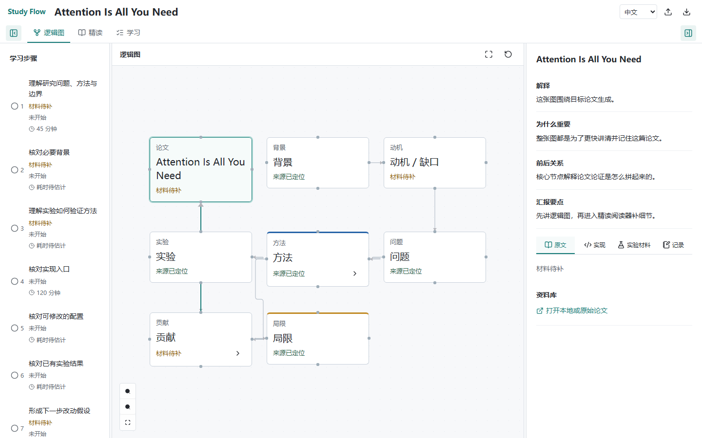

# fields-study-flow

新版三栏研究理解工作台已进行离线桌面与移动端检查，详见[工程验收记录](docs/evaluation/workbench-verification-2026-10-10.md)。实际学习效率与模型对照试用仍待验证，不把页面生成成功当作学习效果证明。



## 研究理解工作台

面向需要理解并接手论文与项目材料的研究者。先提供目标和获准读取的材料，高级设置按需增加：

```bash
fields-study-flow paper --url ./paper.pdf --local-resource ./project --learning-outcome understand --offline --explanation-provider local --output-dir ./research-report --resource-dir ./research-report/study-assets
```

打开 `research-report/index.html`，再进入 `paper_map.html`。B 三栏工作台：左侧必要学习步骤，中间论文逻辑图或段落精读，右侧解释与来源。沿着论点、段落、已有代码/配置/结果定位，再留下自己的回答。笔记和回答通过 `study_state.json` 导出，与公开报告分开；来源指纹变化后重新核对受影响的回答。交接时一起移动**整个报告目录及 study-assets**；资料目录另设时，也需一起移动并保持相对位置。

| 输入 / 参数 | 用途 |
| --- | --- |
| 可重复的 `--local-resource` | 明确提供 PDF、README/Markdown、Python、Notebook、JSON/YAML 配置、CSV/JSON 已有结果或项目目录。只静态分析，不执行项目或重跑实验。 |
| `--learning-outcome understand\|present\|extend` | 看懂问题/方法/边界；增加有出处的汇报；或定位实现/配置/结果并提出后续修改。默认 understand；fast-presentation 对应 present，显式目标优先。原有推导、复现、批判任务保留，不自动完成。 |
| `--known-topic "linear algebra" --level programming=familiar` | 可选已有背景，两项均可重复。水平可选 beginner、familiar、advanced。 |
| `--explanation-provider local\|auto\|llm` | 本地来源约束的阅读辅助、显式启用后的自动选择、或明确请求模型解释。 |
| `--offline` | 关闭生成时全部网络请求，包括检索、下载与解释模型。`--no-live-search` 只控制资料发现。 |

模型解释必须显式配置 `FIELDS_STUDY_FLOW_LLM_ENABLED=true`、`FIELDS_STUDY_FLOW_LLM_BASE_URL`、`FIELDS_STUDY_FLOW_LLM_MODEL`、`FIELDS_STUDY_FLOW_LLM_API_KEY`。端点为用户选择的 OpenAI-compatible 服务，不内置模型或付费服务。auto 未获显式启用时使用 local，不因发现其他密钥就上传材料；llm 缺配置时报错，offline 始终本地。启用前检查材料范围：相关摘录会发送给该端点，费用和数据政策由端点决定。阅读 HTML 和普通快照重导出不再调用解释模型；生成可能计费，来源/配置变化会使解释缓存失效。请求失败会记录警告并降级到本地输出。

**边界：**定位有效、摘录已找到，不代表科学结论正确或用户掌握。自动论文/代码关系保持待核对；缺失材料保持缺口；自我勾选和模型反馈不是独立验证。其他代码格式可能只有文本检索，解析失败和扫描限额会缩小覆盖范围；摘要不能支持完整方法讲解。本次工作台面向单篇论文，原有领域/课程及论文集合入口保留，但不扩展新项目语义。

生成期通过来源校验的模型解释使用私有缓存 `Path.home() / ".cache" / "fields-study-flow" / "explanations"`，不复制进报告。local/offline 跳过模型和缓存访问；显式启用的双语生成在缓存命中前分别进行两次有界语言调用，后续缓存复用和普通导出不增加解释调用费用。校验锚点不等于确认科学正确性或用户掌握。

需要检验的增值是持续保留的跨材料锚点、明确缺口和可重新核对的研究交接。GPT/Claude Agent 也能生成通用图谱、解释及 HTML，这些不作为独占能力或已验证的学习提升。[ChatGPT Study Mode](https://help.openai.com/en/articles/11780217-using-study-mode-in-chatgpt) 和 [Claude Artifacts](https://claude.com/resources/articles/build-artifacts) 是相关基线能力。

[三个离线案例](examples/research-workbench/README.md) 分别是 planning-paper、transformer-paper-project（**自有玩具演示，NOT actual paper reproduction，不是真实论文复现**）和 diffusion-missing-materials。生成器不调用远程 API 或外部 LLM。实际 HTML 和截图需生成、检查后发布，不用占位图冒充截图。[8-12 人试用协议](docs/evaluation/research-understanding-protocol.md) 使用强同模型/同工具预算基线并保留失败案例；人工结果、节省时间和效果比较均为**待执行**。下文历史就绪分数只描述报告检查，不证明学习效果；命令中的示例时间只是语法示例，不是实测结果。

欢迎认领带 fixture 的解析适配、附出处的解释修正、许可清晰并检查材料缺口的跨领域案例，以及可复现的桌面/移动端界面问题。请附来源版本、实际/预期行为和脱敏证据。

## 最新功能快速说明

- 单篇论文路线现在会额外生成 `paper_map.html`，这是一个离线可打开的 Xmind-flow 图形画布：支持节点拖拽、缩放、SVG 因果连线、分支展开/收起，以及右侧证据和汇报话术详情。
- 单篇论文路线也会生成 `paper_lens.html`，这是一个独立的“目标论文增强阅读器”。
- `paper_lens.html` 会按摘要、背景、方法、公式、实验、局限和相关工作组织阅读卡片，并把资料包中的论文、书籍、代码、网页快照和 RAG 证据片段挂回对应章节。
- 新版 Paper Lens 默认生成“原文段落精读流”：悬浮或点击核心段落即可查看直白解释、方法说明、相关资料和证据；如需旧体验可使用 `--paper-lens-granularity sentence`。
- 使用 `--resource-dir` 时，`roadmap.html`、`paper_map.html`、`paper_lens.html` 和 `roadmap.md` 会优先链接到本地已下载/复制资料；未下载或仅链接资料才保留原始网络入口。
- 如果只想保留路线报告，可以在 `paper` 或 `roadmap` 命令中加入 `--no-paper-lens`。
- 共享型 JSON/HTML/MD 仍会隐藏 `C:\private-path`、`D:\private-path` 等本地绝对路径，只保留相对本地链接或脱敏标识。

简体中文 | [English](README.md)

面向 AI/CS 论文、领域和课程学习的 agent-native 掌握路径生成器。

fields-study-flow 可以把“掌握这篇论文”“学习 diffusion models”“复现 YOLO”这类目标，转成一条可追踪、可验证的学习路径。它会综合学习者画像、路线深度、语言偏好、开放来源实时搜索和显式提供的本地资源，最后导出 Markdown、JSON、SVG 和美观的静态 HTML 报告。

<p align="center">
  
</p>

## 它优化什么

- 统一双模式：单篇论文掌握和领域/课程学习共用同一个 planner。
- 掌握标准：讲清楚、推导关键点、复现核心方法、批判局限。
- 路线深度：`fastest`、默认 `balanced`、或 `complete`。
- 学习风格：默认实战复现优先，也支持理论优先、视频优先和自动模式。
- 语言选择：Markdown、HTML、SVG 报告会遵循 `zh-CN`、`en` 或 `bilingual` 输出语言。
- 最短路线：`fastest` 和实战型 `balanced` 会把宽泛前置课程压缩成紧贴目标的前置冲刺。
- 本地资源：只分析用户显式传入的路径，共享输出中不暴露本地绝对路径。
- 论文解析：本地 PDF 会尽量抽取章节、方法/实验/局限提示、关键词、公式候选和代码链接。
- RAG 证据路线：目标论文、本地资源和资料包会被切分成轻量证据片段，写入 `.rag_index`，关键点、推荐理由和验收任务都可以引用来源片段。
- 学习知识图谱：报告会展示本地轻量的 concept -> resource -> task -> assessment 图谱，用于导航和掌握追踪。
- 实时搜索：默认搜索开放官方 API；需要凭证或只适合手动链接的平台不会被自动抓取。
- 路线审计：说明覆盖度、省略资源和预计耗时。路线采用确定性启发式，不保证全局最短或完全掌握。
- 可执行任务：报告包含学习任务、下一步行动、质量门、最终证据和可运行产物验收。
- 文件夹入口：导出后优先打开 `index.html`，它会根据当前计划引导用户进入 Paper Map、Paper Lens 或路线验收清单。
- 学习目标：通过 understand/present/extend 生成必要步骤；新版单篇论文首页只保留一个清晰的开始入口。
- 可带走练习卡：每次导出都会写出 `study_cards.md`，把首页主动回忆小测变成可打印、可复制到笔记里的本地练习集。
- 证据链接小测：每次导出也会写出 `study_quiz.md`，用题目、答案钥匙和证据入口帮助用户快速确认“我是不是真的理解了”。
- 速读 Brief：每次导出都会写出 `quick_brief.md`，用一页内容串起论文逻辑主链、证据入口、核心资料和下一步动作。
- 证据覆盖与掌握就绪：每次导出都会写出 `evidence_coverage.md` 和 `evidence_coverage.html`，标明 Paper Map 结论、Paper Lens 段落、掌握任务和资料是否已有来源证据支撑，并给出可点击证据来源诊断、覆盖分数、解释/推导/复现/批判四门槛就绪评分卡和优先补证据队列。
- 轻量首页：新版研究工作台的 `index.html` 是入口，JSON/Markdown/SVG 是辅助导出，不重复堆叠完整仪表盘。
- 交互式工作台：`paper_map.html` 提供稳定的拖拽图谱；`roadmap.html` 展示学习步骤、全部正式任务、资料库和下载管理；三个页面共享可调整侧栏和本地学习记录。
- 资源来源与覆盖范围：`roadmap.html` 的资料卡会显示资料用途、证据强度、来源类型，以及它覆盖论文逻辑或学习任务的哪一部分，方便用户先打开最有用的资料。
- 可带走的学习记录：正式任务模板保留在 `mastery_worksheet.md`；浏览器中的回答、笔记和自我核对状态单独导出为 `study_state.json`，不自动写入公开报告或认定掌握。
- 资料包开始页：本地资料目录会生成中文优先的 `README.md` 仪表盘，包含 10 分钟开始路径、路线资料、补充资料、仅链接资源和失败重试说明。

## 快速开始

先用零准备 demo 试跑一遍：

```bash
python -m pip install -e .
fields-study-flow demo --output-dir ./fields-study-flow-demo
```

然后打开 `fields-study-flow-demo/index.html`。这个 demo 使用内置 Transformer 论文样例，并自带本地 `study-assets/` 资料包；用户不需要先准备 PDF，就能评估 Paper Map、Paper Lens、本地报告结构、本地优先资料和掌握验收清单是否有用。
入口页里也会直接给出“换成自己的论文”的 URL 和本地 PDF 命令模板。
如果想一条命令同时生成 demo 和市场化审计摘要：

```bash
fields-study-flow demo --output-dir ./fields-study-flow-demo --market-check
```

它会写出 `demo_market_check.json`、`release_readiness.md` 和 `release_readiness.html`，并在 `index.html` 加入发布决策入口。当你已经有真实新用户耗时，并且本机安装了可选浏览器运行时时，可以再加 `--market-fresh-user-minutes`、`--market-check-screenshots` 和 `--market-check-interactions`。

检查导出的 HTML 是否存在常见排版和隐私风险：

```bash
fields-study-flow audit-report --report-dir ./fields-study-flow-demo
```

如果本机安装了 Python Playwright 和浏览器运行时，也可以打开真实桌面/移动端截图捕获：

```bash
python -m pip install -e ".[visual]"
python -m playwright install chromium
fields-study-flow audit-report --report-dir ./fields-study-flow-demo --capture-screenshots
fields-study-flow audit-report --report-dir ./fields-study-flow-demo --probe-interactions
```

截图和相对路径 manifest 会写入 `visual-snapshots/`；交互探针会在浏览器里打开离线报告，冒烟测试 Paper Map 分支展开、节点详情、缩放/平移、Paper Lens 段落选择和 roadmap 资料筛选。如果没有安装可选浏览器运行时，命令会明确显示截图或交互检查被跳过，不影响基础静态审查。

当你确认某次导出的页面足够好看，并且截图捕获已经产生真实 `pass` 截图后，可以把 manifest 保存成黄金基线，后续导出用它做 UI 回归比较：

```bash
copy fields-study-flow-demo\visual-snapshots\manifest.json docs\visual-baselines\demo.manifest.json
fields-study-flow audit-report --report-dir ./fields-study-flow-demo --snapshot-baseline docs/visual-baselines/demo.manifest.json
```

基线检查会比较页面、桌面/移动端视口、尺寸和截图哈希；如果漏掉页面或截图变化，命令会返回失败，适合放进发布前检查。

想验证上手速度时，可以让一位第一次使用的学习者从打开 `index.html` 开始计时，到进入第一项掌握验收任务为止，然后记录耗时：

```bash
fields-study-flow audit-report --report-dir ./fields-study-flow-demo --write-fresh-user-worksheet
fields-study-flow audit-report --report-dir ./fields-study-flow-demo --fresh-user-minutes 8.5
```

worksheet 会让评审者记录每一步、卡点和修复想法。默认目标是 10 分钟；如果你的发布门槛不同，可以用 `--fresh-user-target-minutes N` 调整。超过目标时间时命令会返回失败。

做完多轮新用户测试后，可以把填好的 worksheet 聚合成按频次排序的产品改进 backlog：

```bash
fields-study-flow audit-report \
  --report-dir ./fields-study-flow-demo \
  --fresh-user-worksheet-input ./fields-study-flow-demo/fresh_user_test.md \
  --write-fresh-user-backlog
```

生成的 `fresh_user_backlog.md` 会把重复出现的卡点排在前面，并继续避免泄露本地绝对路径。

跨多个版本或多份报告时，还可以把多个 backlog 聚合成趋势报告：

```bash
fields-study-flow audit-report \
  --report-dir ./fields-study-flow-demo \
  --fresh-user-backlog-input ./fields-study-flow-demo/fresh_user_backlog.md \
  --write-fresh-user-trend-report
```

生成的 `fresh_user_trends.md` 会突出跨报告反复出现的卡点，方便把可用性测试变成持续产品改进闭环。

发布前可以再生成一个给人看的发布决策面板：

```bash
fields-study-flow audit-report \
  --report-dir ./fields-study-flow-demo \
  --capture-screenshots \
  --probe-interactions \
  --fresh-user-backlog-input ./fields-study-flow-demo/fresh_user_backlog.md \
  --write-fresh-user-trend-report \
  --write-release-readiness \
  --write-release-history
```

生成的 `release_readiness.md` 和 `release_readiness.html` 会把 `report_audit.json`、视觉检查、截图/基线状态、浏览器交互探针、新用户耗时和反复出现的卡点合成一个 `ship` / `needs_work` / `do_not_ship` 决策。HTML 版本是单文件离线页面，更适合非技术评审直接打开；`index.html` 也会自动出现一个不重复的发布决策入口，直接链接到这个面板。没有通过新用户计时、真实视觉证据和浏览器交互证据的报告不会被标记为 `ship`。它的门槛明确对齐 Elicit/SciSpace 的证据透明、NotebookLM 式可带走学习产物、ResearchRabbit/roadmap.sh 的可视化导航、React Flow 的画布交互、本地优先资料包，以及可验收掌握证据。
加上 `--write-release-history` 后，还会生成 `release_readiness_history.jsonl`、`release_readiness_history.md` 和 `release_readiness_history.html`，用脱敏的跨版本发布决策记录、趋势摘要、分数变化和反复卡点变化来判断报告质量是否真的在持续变好。报告首页和发布准备度面板都会自动出现一个不重复的质量趋势入口，直接链接到 HTML 面板。
当命令写出这些发布面板时，JSON 输出还会包含 `generated_artifact_audit`，同一次运行就会重新检查刚生成的 HTML 页面，避免新面板没有被视觉和隐私规则覆盖。审计还会检查首页是否有基于学习意图的入口选择，避免用户一打开报告就不知道该先点哪里。

```bash
fields-study-flow roadmap \
  --goal "梳理 diffusion models 领域和关键论文" \
  --preset field-survey \
  --output-language zh-CN \
  --resource-language en-first \
  --local-resource ./my-notes/diffusion \
  --resource-dir ./study-assets/diffusion \
  --bundle-scope all
```

如果不希望实时搜索，可以使用确定性的离线模式：

```bash
fields-study-flow roadmap \
  --goal "掌握 Transformer 论文" \
  --no-live-search \
  --local-resource ./my-notes/transformer
```

论文深读路线：

```bash
fields-study-flow paper \
  --url https://arxiv.org/abs/1706.03762 \
  --preset fast-presentation \
  --output-language bilingual \
  --resource-language en-first \
  --resource-dir ./study-assets/transformer
```

交互向导会先询问语言、存储、学习偏好；如果启用资料包，也会继续询问 `bundle_scope`，再执行规划：

```bash
fields-study-flow paper --interactive
fields-study-flow roadmap --interactive
```

生成完成后优先打开 `index.html`。它会按当前目标给出最清晰的入口：单篇论文通常先进入 Paper Map，再进入 Paper Lens，最后按路线清单验收。

生成文件：

```text
fields-study-flow-output/
  index.html              # 从这里开始：按当前目标推荐最合适的报告入口
  learner_profile.json
  resource_index.json
  local_resource_analysis.json
  source_registry_snapshot.json
  roadmap.md
  roadmap.json
  roadmap.svg
  roadmap.html            # 交互式学习路线和掌握验收清单
  paper_map.html          # 离线 Xmind-flow 目标论文图形画布
  paper_lens.html         # 目标论文增强阅读器
  artifact_template/        # 仅在需要可运行项目或复现验收时生成
    README.md
    task_checklist.md
    reproduction_log.md
    notebook_skeleton.ipynb
    src/main.py

study-assets/
  study_bundle_manifest.json # 设置 --resource-dir 时生成
  README.md                   # 资料包摘要和开始学习说明
  .rag_index/manifest.json   # 用于证据检索和资料包问答
  links.md
  01-selected-local-or-open-resource.pdf
```

使用 `--resource-dir` 时，`roadmap.html`、`paper_map.html`、`paper_lens.html` 和 `roadmap.md` 中已下载/复制的资料会优先链接到本地资料包。原始网页链接仍作为来源或兜底入口展示，共享型输出仍不会暴露本地绝对路径。
资料包里的 `README.md` 可以直接打开：它会显示完成率、推荐前 10 分钟怎么学、路线资料和补充资料分组，以及失败下载如何重试。每次导出也会写出 `mastery_worksheet.md`，带来源锚点和汇报就绪检查，方便写笔记、做汇报或交给别人检查。
新版工作台通过 `study_state.json` 导入导出个人进度，正式任务模板仍是辅助导出；两者都不等同于独立验收。

只基于已经下载/复制的资料包提问：

```bash
fields-study-flow ask \
  --roadmap fields-study-flow-output/roadmap.json \
  --resource-dir ./study-assets/diffusion \
  --question "哪些证据解释了复现目标？"
```

## 关键参数

| 参数 | 含义 |
| --- | --- |
| `--preset fast-presentation\|deep-reproduction\|field-survey\|fastest\|balanced\|complete\|paper-fastest\|paper-deep\|field-project\|course-complete` | 使用首轮上手意图模板或兼容学习模式快速启动；显式参数仍可覆盖 preset。 |
| `--target-kind paper\|field\|course\|auto` | 指定或自动判断论文、领域、课程模式。 |
| `--route-depth fastest\|balanced\|complete` | 控制路线是最短、平衡还是最完整。 |
| `--learning-style practical\|theory\|video\|auto` | 控制资源排序偏向实战、理论或直觉材料。 |
| `--local-resource PATH` | 分析显式提供的本地文件或文件夹，可重复传入。 |
| `--resource-dir PATH` | 将学习资料库复制/下载到私有资料目录，并写出 `study_bundle_manifest.json`。 |
| `--bundle-scope selected\|all` | 控制资料包只下载最短路线资料，还是尝试下载全部可直接获取的候选资料。默认是 `all`；不可获取的资料仍会进入 `links.md`。 |
| `--rag off\|light\|auto\|embedding` | 控制证据检索模式。`auto` 使用轻量本地检索；`embedding` 在安装可选 `rag` extra 后启用。 |
| `--no-paper-map` | 即使存在目标论文，也跳过独立的 `paper_map.html` 论文逻辑图。 |
| `--paper-map-language auto\|zh-CN\|en\|bilingual` | 控制 Paper Map 解释语言。`auto` 会跟随 prompt / 输出语言。 |
| `--paper-map-depth quick\|standard\|complete` | 控制论文逻辑图挂接多少公式、资料、任务和证据支线。默认是 `standard`。 |
| `--paper-map-layout xmind-flow` | 使用 Xmind + 因果流程融合的图形化画布布局，默认就是该布局。 |
| `--paper-map-provider local\|auto\|llm` | 控制 Paper Map 抽取策略。`auto` 默认走本地规则，配置扩展 provider 后可增强。 |
| `--paper-lens-language auto\|zh-CN\|en\|bilingual` | 控制 Paper Lens 句段解释语言。`auto` 会跟随 prompt / 输出语言。 |
| `--paper-lens-density key\|section\|dense` | 控制进入句段级解释的论文片段数量。默认是 `dense`。 |
| `--paper-lens-granularity paragraph\|sentence` | 控制 Paper Lens 默认按段落解释，或切回旧的句子粒度。默认是 `paragraph`。 |
| `--interactive` | 先询问目标、语言、路线深度、学习风格、本地资源、报告目录和资料目录，再执行。 |
| `--no-live-search` / `--offline` | 关闭默认实时搜索，使用确定性目录和显式资源。 |
| `--output-language zh-CN\|en\|bilingual` | 控制路线输出语言。 |
| `--resource-language zh-first\|en-first\|balanced\|zh-only\|en-only` | 控制资料语言偏好。 |

本地资源支持 Markdown、TXT、TeX、PDF、Jupyter Notebook、Python、YAML/JSON/CSV，以及常见文档和课件格式的元数据级分析。资料打包只复制用户显式提供的路径。默认 `--bundle-scope all` 会尝试下载全部可直接获取的候选资料，包括 arXiv PDF、GitHub raw 文件、公开 GitHub 仓库归档，以及服务器允许时的普通公开网页 HTML 快照；`--bundle-scope selected` 则保留更快的最短路线资料包行为。视频、受限页面、失败下载和需要凭证的来源会保留在 `links.md` 中，manifest 会记录 selected/omitted 以及 downloaded/link-only 状态。

embedding 检索是可选增强：

```bash
python -m pip install -e .[rag]
```

## MCP 风格工具

运行 JSON-lines 工具服务：

```bash
python -m fields_study_flow.mcp_server
```

示例：

```json
{"tool":"searchResources","arguments":{"query":"Transformer derivation","languagePreference":"en-first"}}
```

可用函数：

- `assessKnowledge`
- `discoverSources`
- `searchResources`
- `analyzeLocalResources`
- `ingestUrl`
- `rankResources`
- `buildRoadmap`
- `retrieveEvidence`
- `answerFromBundle`
- `validateSources`
- `exportPlan`

`exportPlan` 会写出 JSON、Markdown、SVG、HTML、`quick_brief.md`、`evidence_coverage.md`、`evidence_coverage.html`、`study_cards.md`、`study_quiz.md` 和 `mastery_worksheet.md`；当路线需要可运行项目或复现验收时，还会写出 `artifact_template/` 模板包。
模板包会遵循所选输出语言；如果有论文解析结果，也会写入公式、代码链接、实验和局限相关验收目标。

交互式 HTML 是单个可离线打开的文件，不依赖前端框架、远程字体或在线脚本。任务进度会在浏览器允许时写入 `localStorage`；如果浏览器阻止本地存储，报告仍然可以阅读和点击，只是勾选状态作为临时状态处理。

在 Windows PowerShell 中读取导出的 JSON 时，建议显式使用 UTF-8：

```powershell
Get-Content .\fields-study-flow-output\roadmap.json -Raw -Encoding UTF8 | ConvertFrom-Json
```

## 架构

```text
目标/画像
  -> 统一规划参数
  -> 实时搜索 + 离线目录 + 显式本地资源
  -> 轻量 RAG chunk + 证据检索
  -> 轻量学习知识图谱
  -> 排序、去重、质量/风格加权
  -> 按路线深度选择掌握路径
  -> 掌握图谱 + 路线审计 + 质量门 + 最终产出 + 检查点
  -> Markdown / JSON / SVG / HTML 输出 + 可选验收模板包
```

核心模块：

```text
fields_study_flow/
  live_search.py      # 开放 API 搜索与凭证安全降级
  local_resources.py  # 显式本地路径分析
  paper_metadata.py   # arXiv/DOI/本地 PDF 元数据与降级解析
  paper_map.py        # Xmind-flow 单篇论文图模型与离线 HTML 渲染
  paper_lens.py       # 目标论文精读层、章节证据和本地优先链接
  artifact_templates.py # 缺少可运行资源时生成验收模板
  rag.py              # 本地证据片段、资料包索引、检索和资料包问答
  knowledge_graph.py  # 本地概念/资源/任务/验收学习图谱
  ranking.py          # 质量、语言、耗时、学习风格评分
  roadmap.py          # 掌握图谱、路线选择和渲染器
  mcp_tools.py        # agent 可调用函数
  cli.py              # 命令行入口
```

## 安全边界

fields-study-flow 只推荐、摘要和链接资源。它不会默认扫描本地磁盘，不会在共享输出中暴露私有路径，不会绕过登录或付费墙，不会下载视频，不会使用盗版镜像，也不会复制长篇版权内容。所有外部内容都应被视为不可信来源材料。

## 开发

```bash
python -m pip install -e .[dev]
pytest -q
```

MIT。见 [LICENSE](LICENSE)。
